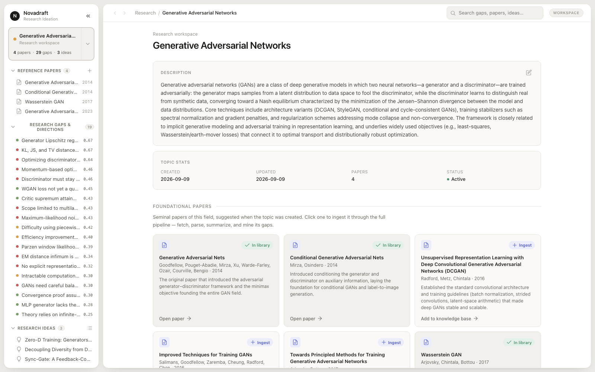

# Novadraft

A **co-living research ideation workspace**: a persistent environment where a
researcher and a Mulit-Agentic system together build up a knowledge base of papers, research
gaps and ideas over mulitple sessions.

You give it a topic and some papers. It reads them, mines the open problems out
of them, checks each one against the literature to see whether it is actually
still open, and ranks what remains. From there you work the gaps into ideas in a
chat-like session with an ai agent as an assistance, with him proposing, arguing and refining alongside you.
Everything lands on disk as plain JSON, so the workspace is still there tomorrow.



---

## How it works

A topic is a **workspace** — a folder of JSON records that every agent reads from
and writes back into. Two things happen in it.

**Ingestion** turns a paper into ranked, verified research gaps. One LangGraph
pipeline (`src/graph/pipeline.py`) runs the stages end to end:

| Stage | Agent | What it does |
| --- | --- | --- |
| Ingest | `paper_agent` | Fetch → extract → summarize → mine gaps from one paper |
| Dedup | `director_agent` | Merge each new gap into a known one, or mark it novel |
| Validate | `validator_agent` | Search the literature for prior art; is this gap still open? |
| Rank | `ranking_agent` | Score what's still open on openness, impact, feasibility |

A gap moves through the workspace as it goes: `gaps/pending/` →
`gaps/to_validate/` → `gaps/to_rank/` → `gaps/master/`.

**Ideation** is the conversation on top of that knowledge base. Each turn is
planned by the `orchestrator_agent`, which reads your message plus whatever you
loaded into context and decides who to call: the `investigator_agent` (convergent
— goes and finds evidence) or the `creative_thinker` (divergent — a tree of
thoughts that generates and refines candidate ideas). A turn that would call a
subagent shows you its plan first, editable, and runs nothing until you press
Start. Everything an agent produces arrives as a **draft** you accept or dismiss;
nothing is written into the knowledge base behind your back.

Every run — ingestion or ideation — streams as a flat `.jsonl` event log, which
is the same stream the UI renders live and replays afterwards.

---

## Running the UI

Needs Python ≥ 3.11 and Node. From this directory:

```bash
./app/start.sh
```

That starts the FastAPI backend on **:8787** and the web app on
**http://localhost:5173**, installing frontend dependencies on the first run.
Ctrl-C stops both. For the desktop build (Tauri) and for running the two halves
in separate terminals, see [`app/README.md`](app/README.md).

Set your API keys in `.env` first:

```
DEEPSEEK_API_KEY=...
```

Without a key the agents still run end to end against a deterministic mock, so
the UI is explorable offline — the LLM responses are just empty stubs.

---

## Where your work lives

Everything is on disk under **`workspace/`** in this directory, one folder per
topic. Point `NOVADRAFT_WORKSPACE` at another path to move it.

```
workspace/<topic_slug>/
├── meta.json                  # topic name, description, timestamps
├── papers/<paper_id>/
│   ├── paper.json             # metadata, summary, contributions, limitations
│   ├── source.pdf
│   └── source/                # extracted LaTeX tree, when available
├── gaps/{pending,to_validate,to_rank,master,archive}/
│   └── <gap_id>.json          # one record per gap, at its current stage
├── ideas/<idea_id>.json       # the idea, its sections, and every run that shaped it
├── sessions/<session_id>/     # chat transcripts + the drafts a run produced
└── logs/<agent>/<run_id>.jsonl
```

`paper_id` is derived from the input (`arxiv_<id>`, `doi_<slug>`, or a title
hash), so re-adding the same paper is a no-op. Every path is built in
`src/common/utils/storage.py` — the only module that constructs workspace paths.

---

## Repository layout

```
app/            The product: FastAPI backend + React/Vite frontend (+ Tauri desktop shell)
src/
├── agents/     One folder per agent; each exposes a MANIFEST and a LangGraph builder
├── graph/      The end-to-end ingestion pipeline composing those agents
├── llm/        registry.py — the single LLM access point (role → model)
└── common/     Shared across agents: storage, schemas, run logging, agent registry
tests/          pytest suite (network tests are opt-in: `pytest -m live`)
docs/           Supplementary notes
